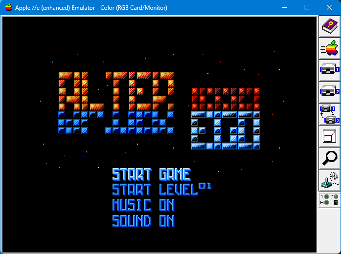
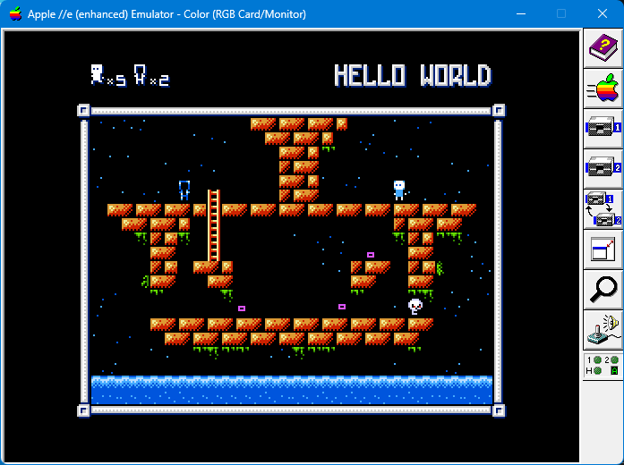

# Alter Ego — Apple II VERA Port

This repository contains the Apple II VERA port of the NES homebrew game
Alter Ego. The original NES source is available at
[github.com/avshabanov/alter-ego](https://github.com/avshabanov/alter-ego).





## Build and run

The image builder and packer are kept in this repository. It bundles the Cadius
Windows executable, the Applesoft BASIC compiler, the PSG stream
validator, the ProDOS 2.4.3 boot image, the assembly include used by this port,
and the converted music/effect streams. No sibling `veratest` or `veramusic`
checkout is needed.

Building still requires Python 3, Node.js, and the cc65 toolchain (compiler,
assembler, linker, Apple II headers and libraries). Put `cc65.exe` on `PATH` or
set `CC65_BIN` to cc65's `bin` directory. FamiStudio and
`C:\dev\veramusic\tools\ftmplay.exe` are only needed when regenerating the
checked-in music streams; set `FAMISTUDIO` and `FTMPLAY` to their executable
paths when running `tools/famitone2vera_psg.mjs` manually.

Supported machines are Apple II Plus and newer compatible Apple II models
with expansion slots, including enhanced Apple IIe. An Apple II+ needs 48 KB
plus a 16 KB Slot 0 Language Card. VERA can be installed in Slot 2 or Slot 4;
startup detects the slot and runs its matching game and music binary. The build
targets the NMOS 6502 through cc65's `apple2` target and library. The game uses the
Apple II's main RAM and VERA's own VRAM; it does not use the IIe's auxiliary
64 KB RAM. It provides 320x240 tile/sprite graphics and VERA PSG.
The default PSG build creates the bootable image
`build/a2vera/alter-ego-vera-psg.hdv` (800 KB ProDOS, volume `ALTER.EGO`). It
contains all 26 source levels, title/game-over/ending art, ten background
songs and 15 converted NES effects. DHGR/Mockingboard was explored and closed:
preserving the NES screen detail required remaking art and text, so VERA is the
only Apple II graphics/audio target. The FTM build also has a dual 140 KB
floppy release below.
The PSG disk's startup title identifies it with `PSG VER` at the right edge.

Both HDVs are ordinary 800 KB ProDOS volumes containing the game as files.
For a file-level install, copy the complete contents of the chosen HDV volume
to the root of another ProDOS volume, then boot that volume and run `STARTUP`.
Keep each version's files together on the same volume: PSG includes its `.PSG`
tracks and `SFXBANK`, while FTM includes its music overlays and FamiTone data.

### FTM and PSG versions

| | Live FTM | Streamed PSG |
|---|---|---|
| Choose when | You want compact, live playback of the original NES FamiTone song data and steady music during play | NES sound fidelity and 60 Hz visual updates matter most |
| Music | Original FamiTone song data decoded by the 6502 and played through VERA PSG | Converted `.PSG` event streams played from VERA VRAM |
| Effects | Original FamiTone effects resident in RAM | Converted `SFXBANK` effects cached in VERA VRAM |
| Gameplay timing | About 40 display iterations/s; logic alternates 2 and 1 NES steps per iteration to approach 60 steps/s | About 60 display and logic iterations/s |
| Loading | Music pauses while a level is read and drawn, then resumes or starts the next theme | Music pauses while a level is read and drawn, then resumes or starts the next theme |
| 800 KB HDV | `alter-ego-vera.hdv`: 40 files, 438 blocks used | `alter-ego-vera-psg.hdv`: 51 files, 617 blocks used |
| 140 KB floppy release | Two disks, D1 and D2 | No floppy release |

Both versions contain the same levels, graphics, and controls. PSG is the
choice for sound closest to the NES; FTM plays the original FamiTone modules
live for compact, steady music. Normal gameplay audio playback uses resident
RAM or VERA VRAM and does not read the disk. FTM's live decoding costs CPU
time, as reflected in the display rates above.

```powershell
iex (Get-Content -Raw build/a2vera/build_a2vera.ps1)
$appleWin = '<path-to-AppleWin-VERA-fork>\AppleWin.exe'
$image = (Resolve-Path 'build/a2vera/alter-ego-vera-psg.hdv').Path
Start-Process $appleWin -ArgumentList @('-h1', $image, '-s6', 'empty', '-s7', 'hdc', '-model', 'apple2ee', '-s2', 'vera', '-no-full-screen', '-power-on')
```

To test a Slot 4 card in AppleWin, replace `-s2 vera` with `-s4 vera`.

### Live FamiTone build

The default image above streams converted `.PSG` music. The FTM image plays the
original FamiTone v1.24 song data directly through VERA's PSG, reducing disk
use. Both versions are playable and have been confirmed by the user. Build the
FTM image with:

```powershell
$env:CC65_BIN='C:\dev\cc65\bin'
$env:AE2VERA_FTM_BUILD='1'
iex (Get-Content -Raw build/a2vera/build_a2vera.ps1)
```

This creates `build/a2vera/alter-ego-vera.hdv`. The PSG variant keeps the
`-psg` suffix and remains the default when `AE2VERA_FTM_BUILD` is unset.
Cadius reports 438 disk blocks used versus 617 in
the PSG image, freeing 179 blocks (91,648 bytes allocated) and removing 11
files. AppleWin has reached the title and Level 1 on this image. The live
player's first Level 1 chord now writes the expected 330 Hz and 196 Hz pulse
tones plus a 263 Hz triangle tone. A ProDOS buffer collision that erased some
pitch entries was fixed; the game music clock was also brought close to the
source's 60 Hz rate. The buffer now occupies `$0C00-$0FFF`; the old `$8400`
buffer overlapped the phase table at `$8500`. AppleWin timing traces show
Level 1 beat intervals typically around 0.33-0.36 seconds, close to the
0.333-second source interval. The FTM title module uses its original seven-tick
row speed at one source tick per 60 Hz VSYNC. Its envelope interpreter runs in
6502 assembly, leaving enough CPU time for roughly 40 display iterations per
second in Level 1.
Gameplay logic and SFX advance alternately one or two NES frames per iteration:
AppleWin measured 185 logic frames in three seconds at idle and 63 in one
second while moving. A completed fall waits for its landing cell's item check
before accepting a new horizontal move. Level music advances alternately one or
two source ticks
per iteration; title music and sound-test BGM 00 advance one source tick per
display iteration, matching the original FamiTone clock. The title tempo was
confirmed by listening in AppleWin. FamiTone SFX repeat lengths and initial
pulse/noise control values are also corrected. In the T sound-test menu, BGM 0
uses the title playback path;
other BGM uses one FamiTone tick per VSYNC. Gameplay keeps its separate tempo
compensation. Both builds use the original game's Level 2 Alt arrangement:
the PSG image selects `LEVEL2ALT.PSG`, while the FTM image uses its native
second level module. Its native directory duplicates that module at index 3,
so FTM gameplay selects indices 1, 2, 4, 5, 6 for the five level themes.
Both sound tests list BGM 00-07. FTM skips the duplicate Level 2 directory
slot; BGM 02 is the formal Level 2 theme and BGM 07 is the ending. The FTM
image builds successfully and has been accepted in gameplay and listening tests.
The title theme now loops from the beginning after its ending note tail, with
the former long terminal silence removed.
Details and memory map are in
[`docs/FAMITONE-VERA-PSG.md`](docs/FAMITONE-VERA-PSG.md).

In both PSG and FTM builds, music is deliberately silent while a level is
read and drawn. A continuing theme resumes from the same position after the
scene appears; a changed theme begins then. Loading can still create a brief
pause between songs. Playback remains steady during normal gameplay.

### Dual 5.25-inch FTM disks

The FTM version also builds as two 140 KB ProDOS floppy images:
`build/a2vera/alter-ego-vera-D1.po` (`ALTER.EGO`) and
`build/a2vera/alter-ego-vera-D2.po` (`ALTER.EGO.2`). D1 holds ProDOS,
startup, both Slot 2/4 binaries, and the resident FamiTone player/data. D2
holds all 26 levels, graphics files, and a startup-check marker. Before
launching the game, STARTUP checks D2 and displays
`PLEASE INSERT DISK 2 IN DRIVE 2` if it is missing. Press a key after
inserting D2 to retry. Mount D1 in Drive 1 and D2 in Drive 2 of the same Disk
II controller, then boot D1. The floppy startup loads the matching VERA-slot
binary from D1 and sets the ProDOS prefix to D2 before the game opens its
assets. Both disks are required; use the HDV for a single-volume install.

To rebuild the floppy pair alongside the FTM HDV:

```powershell
$env:CC65_BIN='C:\dev\cc65\bin'
$env:AE2VERA_FTM_BUILD='1'
$env:AE2VERA_FTM_FLOPPY='1'
iex (Get-Content -Raw build/a2vera/build_a2vera.ps1)
```

For AppleWin, mount both images as Disk II drives:

```powershell
$d1=(Resolve-Path 'build/a2vera/alter-ego-vera-D1.po').Path
$d2=(Resolve-Path 'build/a2vera/alter-ego-vera-D2.po').Path
Start-Process '<path-to-AppleWin-VERA-fork>\AppleWin.exe' -ArgumentList @(
  '-d1',$d1,'-d2',$d2,'-s6','diskii','-s7','empty',
  '-model','apple2ee','-s2','vera','-no-full-screen','-power-on')
```

AppleWin booted the pair with Slot 2 VERA through Title and Level 1, and with
Slot 4 VERA into a playable level. Both volumes pass `CHECKVOLUME`; D1 has 79
free blocks and D2 has 34. The pair uses the same FTM game binaries as the HDV.

At boot, `STARTUP.BAS` checks for the VERA card and shows
`BY ANOMIXER https://github.com/anomixer`, the keyboard/joystick controls
(including `M` for music mute and `N` for sound mute), and
the `HIT ANY KEY OR WAIT 5 SECS TO START...` prompt. Press any key to continue,
or wait five seconds.
Stop AppleWin before rebuilding; the build script does this automatically.
Intermediate files under `build/` are ignored by Git. The FTM HDV and two
floppy images are tracked release artifacts; the build script is tracked too.

Cold boot shows the original Credits shifted upward, followed by the added
`APPLE II VERA CONVERSION BY` / `ANOMIXER 2026` signature. After 2.5 seconds it
continues to the title; Space or joystick button 2 skips the intro. Title music
starts at the title. The PSG HDV contains 51 files and the FTM HDV 40; the
floppy pair stores 7 files on D1 and 34 on D2, including the D2 startup marker.

| Input | Action |
|---|---|
| WASD / arrow keys / joystick | Move/climb |
| J / K / joystick button 1 | Exchange Egos |
| Space / joystick button 2 | Start/pause; confirm Resume or Restart |
| W / S / Up / Down / joystick while paused | Choose menu entry |
| Left / Right on title | Change selected level, or toggle selected audio option |
| Space on title | Start selected game/level, or toggle selected audio option |
| G | Detect a joystick connected or enabled after boot |
| M | Toggle background music mute (game effects remain audible) |
| N | Toggle game sound effects (background music remains audible) |
| 1 on title | Select hidden cow level |
| T on title | Sound Test (shows SFX NN / BGM N): WASD selects, K plays, J stops, M/N toggle audio and update the title labels, T or Esc exits |

The joystick uses the Apple II game port (PDL0/PDL1 and two buttons), with a
centre dead zone and one Start/pause event per press. A disconnected controller
is ignored. In AppleWin, configure **Joystick 1** in the Input settings for
your PC joystick/gamepad, or NumPad for keyboard joystick emulation. NumPad
4/6/8/2 are directions, 0 is button 1, and decimal is button 2. The game reads
the emulated Apple II port; a USB gamepad must be mapped by AppleWin.

Apple II+ keyboards do not report key release, so a direction continues moving
after one press until another key is pressed (or a level reload resets input).
This is a hardware limitation; enhanced Apple IIe keyboards report held state,
so movement stops when the key is released.

The source title code `K, A, J, K, A, J` enables Select (`1`) level skipping.
Restart spends a reserve; zero reserves still permits the current final life.
The title menu lists START GAME, START LEVEL, MUSIC ON/OFF, and SOUND ON/OFF
with equal vertical spacing and left-aligned labels. Left/Right or Space on an
audio row toggles that setting and updates its ON/OFF label immediately.
Pause offers Resume,
Restart (while reserves remain), and Exit Game; with zero reserves it offers
Resume and Exit Game.

## Verification

Actual AppleWin runs have loaded all 26 levels and reached the ending using
Select skips, with snapshot checks for maps, CHR banks, intact program memory,
unused sprites and pause state. A normal Level 1 solution collected both item
kinds and advanced to Level 2 without cheats. The clear message now erases the
whole two-row level name, including its rightmost letters.

The FTM build checks item pickup at every eight-pixel fall boundary, including
the boundary between two NES logic steps in one display iteration. AppleWin
regression tests collected the falling item stacks in Levels 7 and 10; the
same boundary check accepts an exchange during Level 24's rightward fall.
The Level 7 test cleared the stage and advanced to Level 8.

Title navigation updates only the palette attributes of the old and new menu
rows; it redraws text only when its value changes. The pause menu redraws its
sprites only when the cursor moves or blinks, and the paused FTM player skips
its per-frame music-register writes. AppleWin measured 60.5 title iterations/s
idle, 60.1 while navigating, and 60.7 pause iterations/s. The FTM menu and
Level 7 regressions, and the PSG menu regression, passed after the change.

Level loading hides the display layers while replacing the map and palette,
then restores them with the palette already at its fade-in starting brightness
to avoid a bright-to-dark flash.

Assembly OAM reduced rendering cost; one measured run reached 59.59 updates
per second. Song data is cached in VERA VRAM, so normal music playback does
not read the disk. When a level clear will change tracks, the next song is
prefetched in 256-byte chunks during the clear sequence and becomes available
immediately at the transition. The PSG build incrementally loads the fixed-slot
SFXBANK into free VERA VRAM ($E000-$F67F) on the title screen. Starting or
playing an effect then reads only VRAM and writes VERA voices 4 and 5; there
are no ProDOS reads in the gameplay SFX path. Changing the Start Level number
does not read its BGM; after Start is confirmed, the selected song is prefetched
during the start transition. During play, a level-clear transition reads
the next BGM in bounded 256-byte chunks. A brief pause may occur while a level
is loaded and its BGM is made ready. Once play is underway, normal music and
SFX playback use VERA VRAM without disk access, so audio does not stall the
gameplay loop. If music stays muted through level entry, turning it back on may
load the requested song and briefly pause. Sound effects advance once per game
frame at the measured ~60 Hz cadence. Pause resumes music at its previous
position.
The latest SFX conversion raises effect 9 and corrects the noise pitch and
duration for effects 11 and 12; please check those entries in the T sound test.
Music conversion uses FamiStudio WAV stems for the tonal voices and volume
envelopes, while noise pitch follows each FTM note's NES APU period. The same
PSG streams play in `psgplay` and in the game. Conversion doubles the
per-voice amplitude through VERA's logarithmic volume table (about +6 dB,
capped at the hardware limit); an offline Level 1 render measured +3.1 dB RMS
overall. Game sound effects use paired PSG voices for about +6 dB.
Full NES differential playthrough is still required before claiming 100% parity.

Tools and runtime notes are described in [AGENTS.md](AGENTS.md) and
[the runtime notes](docs/APPLE2-REWRITE.md). AppleWin regression scripts write
temporary captures under `build/a2vera/shots`. Run them with
`iex (Get-Content -Raw tools/a2vera_smoke.ps1)` or
`iex (Get-Content -Raw tools/a2vera_gameplay_test.ps1)`.

## Credits

* [Pouët production page](https://www.pouet.net/prod.php?which=71667)
* [ZX Spectrum Alter Ego entry](https://spectrumcomputing.co.uk/entry/26211/ZX-Spectrum/Alter_Ego)
* [Original NES Alter Ego source](https://github.com/avshabanov/alter-ego)

Bundled third-party components and their licenses/provenance are listed in
[THIRD_PARTY_NOTICES.md](THIRD_PARTY_NOTICES.md).

## Links

* [Programming NES games in C](http://shiru.untergrund.net/articles/programming_nes_games_in_c.htm)

