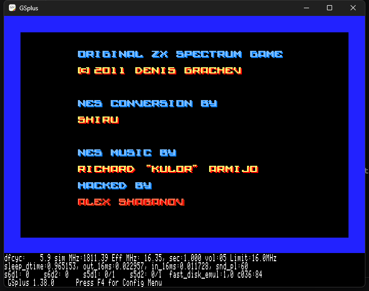
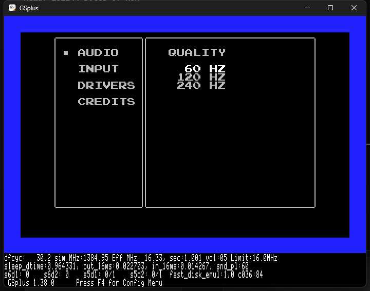

# Alter Ego — Apple IIgs / silky-gs port

This directory is the Apple IIgs work for the cc65 NES homebrew **Alter Ego**, built on
[silky-gs](https://github.com/lscharen/iigs-game-engine) (a native 65816 NES runtime, not an emulator).

This `iigs/` tree is added **alongside** the existing Apple II VERA port in this repository; the VERA
sources, tools and docs are not replaced or deleted.

It is a snapshot of the working tree that was used to bring Alter Ego up on GSplus, including the
current bootable 3.5" image:

- **Boot image:** [`emu/AlterEgoJml.2mg`](emu/AlterEgoJml.2mg) (10 MB ProDOS image)
- **Application:** [`src/games/alterego/AlterEgoGS`](src/games/alterego/AlterEgoGS) (312,871 bytes)
- **Current screen:** 
- **Credits:** 
- **Title:** 
- **Runtime options:** 

## Current status (2026-10-29, branch `test/gs`)

- Boots on GSplus; title → level 0 is playable, with music and SFX enabled.
- Playfield is the NES 32×20 tile map at **256×200** displayed inside the 320×200 SHR screen.
- Single gameplay band: SHR lines 0–199 map to NES rows 16–215 (`y_offset=16`).  The HUD stats,
  outer frame and playfield share the same source band; the frame lands flush on the last SHR line
  (no blank rows below it).  Gameplay sprites use compact OAM coordinates (`GRID_COMPACT_SPRITES=1`).
- The credits and title screens are full-screen NES content; they render with a `YOffsetAbs` of 31.
  The title is rendered with `scroll(...,8)`, lifting the ALTER EGO logo one tile; its four menu
  rows are written one tile lower in the nametable so the menu and cursor stay on their original
  screen rows, and the title art keeps its original palette attributes.  The credits block remains
  vertically centred in the 200-line SHR viewport.
- Gameplay uses the dirty-grid renderer (`ENABLE_DIRTY_RENDERING=1`): only changed background cells
  and sprites are emitted each frame.  The HUD activation check uses the `OAM_COPY` first word, not
  `spriteCount`.
- At the factory **2.8 MHz** setting gameplay renders at about **30 fps**.  The game's every-16-frames
  background CHR pattern-table toggle (`bank_bg`) is avoided, because the toggle forced a full-screen
  tile redraw and limited the port to roughly 12 fps.  Instead, the port keeps pattern page 0 and
  copies the page-1 water variants into spare page-0 tiles `$E0–$E3`; every 16 frames it rewrites
  only the water nametable cells with `vram_adr`/`vram_put`.  The sea therefore animates at the
  original cadence while the rest of the playfield stays static and the dirty grid still runs at
  full speed.
- The core engine is the upstream **silky-gs v0.0.2** tag (`0c341d2`), merged onto the port's
  v0.0.1-based work.  v0.0.2 changes the keyboard layer (BASIC driver only; the J13/ADB drivers are
  compiled out here), reads A/B from the Command/Option push buttons in the configuration screen,
  and suspends/resumes the engine's interrupt handling while the control panel is open.  The port
  keeps its own `yieldFrame`, `YOffsetDyn`/`LayoutActiveDyn` direct-page fields, startup border
  diagnostics, and the `OAM_COPY` HUD probe.
  - Upstream v0.0.2 itself defaults to BASIC (`KBD_J13=0`, `KBD_ADB=0`); J13 and ADB are optional
    flags that also need their source files added to `src/runtime/code.txt` (ADB additionally needs
    `rom_kbd_j13.s`).  This port follows that default.  BASIC is sufficient for Alter Ego's
    one-key-at-a-time `_pad_poll` shim and avoids the ADB driver's known control-panel limitation
    (`ToBRAMSetup` drops its SRQ routine until the panel is closed).
- The title uses the VERA port's four-button menu: **START GAME**, **START LEVEL** (0–25; 0 is the
  hidden Cow Level),
  **MUSIC ON/OFF**, **SOUND ON/OFF**.  The old blinking `PRESS START` prompt is hidden on both
  nametables so the menu is the only title prompt.  The menu is drawn into both nametables, and the
  title's scroll y=8 keeps the renderer on nametable 0 while lifting the logo one tile.
- Credits stay on nametable 0.
- Audio is the original FamiTone2 driver and data, routed through the silky-gs APU model.  FamiTone
  is 8-bit code and its APU trampolines start at `$7E30`; both details are required, otherwise the
  status write corrupts the following APU instructions (the old `Emulated state corrupt` crash).
  **MUSIC OFF** on the title menu also suppresses gameplay and ending music, not just the title theme.
- A host loopback capture of GSplus gameplay measured RMS 3532 / peak 27610, confirming that the
  emulator is producing the game's music/SFX, not just running silently.

## Repository layout

```
iigs/
  src/games/alterego/    Alter Ego port: Main.s, Config.s, Hooks.s, game C/asm, assets, build.js
  src/core/, src/ppu/    silky-gs engine (the runtime this port is built on)
  scripts/               build, palette and image tooling
  macros/, src/rom/      shared Merlin32 macros and NES-ROM wrappers
  emu/AlterEgoJml.2mg    current bootable image (also the image the user reviews)
  emu/gsplus-*.kegs      GSplus configuration; s7d1 points at AlterEgoJml.2mg
  docs/screenshots/      reference captures
  docs/SILKY-GS-UPSTREAM-README.md   upstream silky-gs README
  AGENTS.md              working log, constraints and next steps
  CLAUDE.md              upstream engine guide (kept for reference)
```

## Build

Prerequisites (Windows): Node.js, Merlin32 and Cadius. The tool paths are in `package.json` under
`config`:

- `merlin32`: `C:\dev\Merlin32.exe`
- `cadius`: `C:\dev\cadius.exe`

From the repository root:

```powershell
cd iigs\src\games\alterego
node build.js
```

The build prints the segment sizes and writes `AlterEgoGS` (312,871 bytes). The input
`src/games/alterego/prg.bin` must stay exactly 32,768 bytes.  The committed `prg.bin` is built from
`C:\dev\alter-ego\build\silky\variants\game_apop1.c` with the VERA-style title menu and pause
**EXIT GAME** added, the water-only nametable animation folded into the source (`bank_bg(0)` plus
the `$E0–$E3` page-0 wave tiles), and the FamiTone audio driver/objects linked as before.  The title
keeps the original `src/title.h` palette data and lifts the logo with a scroll of y=8; the last-life
pause menu hides RESTART and moves EXIT into its row.  The old `build/silky` object files are not used
for this revision;
re-derive any binary patch from a fresh link if you rebuild the PRG.

## Repackage the boot image

Cadius replaces a file in place; stage the app under its ProDOS name first:

```powershell
cd iigs
New-Item -ItemType Directory tmp\repackage -Force | Out-Null
Copy-Item src\games\alterego\AlterEgoGS 'tmp\repackage\AlterEgoGS.S16#B3DB03' -Force
& C:\dev\cadius.exe REPLACEFILE .\emu\AlterEgoJml.2mg /ALTEREGO 'tmp\repackage\AlterEgoGS.S16#B3DB03'
```

The image in `emu/` is a build artifact as well as the reference image, so replace it deliberately.

## Run in GSplus

`emu/gsplus-alterego-jml.kegs` has `s7d1` pointing at this checkout:

```powershell
Start-Process C:\dev\emu\GSplus\gsplus.exe `
  -ArgumentList '-cfg', (Resolve-Path .\emu\gsplus-alterego-jml.kegs)
```

Wait about **20 seconds** for the boot at 16 MHz, or **2–3 minutes** at the factory 2.8 MHz
(`g_limit_speed = 2`), then use **X** / **Z** (or Up/Down) to choose a title-menu line and
**Return** or **P** to start. Earlier inputs are lost; GSplus needs the window focus. The `.kegs`
path is absolute, so edit `s7d1` if the repository is checked out somewhere else.

Gameplay now uses the dirty-grid path above; on the 2.8 MHz setting it keeps the original
SHR 0–199 / NES 16–215 mapping, so the playfield position does not move while only dirty cells are
redrawn.  The full-screen 16-frame pattern toggle is replaced by the water-cell rewrite described
above, so the sea animates without dropping below about 30 fps.

## Controls

The game keeps the original NES control scheme.  The keyboard mapping implemented by
`_pad_poll` in `src/games/alterego/neslib_silky.s` is:

| Input | NES function |
|---|---|
| Arrow keys | D-pad |
| **Z** or **Space** | **A** |
| **X** | **B** |
| **Return** or **P** | **Start** |
| **Tab** | **Select** |

The title menu also accepts **X** as “next line” and **Z** as “previous line”, so it can be driven
without the arrow keys; **Left/Right** adjust the START LEVEL value.  The pause menu accepts **X** /
**Z** the same way.

### Title menu

- **START GAME** — start at level 1.
- **START LEVEL** — choose level 0–25 with **Left/Right**; 0 is the hidden Cow Level, while
  **START GAME** always starts at level 1.  The number is shown at the end of the row.
- **MUSIC ON/OFF** and **SOUND ON/OFF** — press **Return/P** to toggle, or **Left/Right** to toggle.
- Press **Return/P** on **START GAME** or **START LEVEL** to begin.

### Pause menu

In game, **Return/P** opens the pause menu.  Choose **RESUME**, **RESTART**, or **EXIT GAME** with
Up/Down (or X/Z), then press **Return/P**.  **EXIT GAME** sits directly under **RESTART** and returns
to the title menu; **RESTART** restarts the current level.  When the HUD shows **0** lives left
(the last life), **RESTART** is hidden and **EXIT GAME** moves into its row; Up/Down still work and
only the remaining choices are selectable.

> The earlier Command/Option, Alt/F1 and Windows-key instructions were wrong for this build.  The
> actual A/B keys are **Z/Space** and **X**; Command/Option and Alt/F1 are not read by the game.

## silky-gs options

This build turns on the silky-gs runtime options menu (`NO_CONFIG=0` in `Config.s`).
While the game is running, press **?** (Shift-/) to open it.  In silky-gs v0.0.2 the engine
suspends its interrupt handling while the panel is open and resumes it on return, which fixes the
hard-to-press control-panel key path.  The top-level panels are:

- **AUDIO** — 60/120/240 Hz mixing rate; this build defaults to 60 Hz.
- **INPUT** — the four direction keys and the A/B buttons.  A/B read the Command/Option push
  buttons (`$C061`/`$C062`) by default; the game itself still reads its own keyboard shim, so the
  documented Z/Space and X controls below remain the in-game A/B.
- **DRIVERS** — this build ships only the BASIC keyboard driver; the J13 and ADB drivers are
  compiled out, matching silky-gs v0.0.2's default.  The LATCH DIRS option is visible while BASIC
  is selected.
- **CREDITS** — project credits.

Arrow keys move between items, **Space** toggles or activates the selected item, and
**Return** accepts the settings and returns to the game.  `CONFIG_VIDEO_MENU`,
`CONFIG_GAME_MENU`, `CONFIG_INPUT_2P` and `JOYSTICK_SUPPORT` are still off, so the
corresponding video, game, player-2 and joystick panels are not present.

## Legacy title secrets

The NES title secrets are still present in the game code, but the IIgs keyboard shim reads only one
key per poll.  As a result the simultaneous **A+B** Sound Test and the **Tab+Return** Cow Level
chord cannot be entered reliably from the keyboard.  The sequential level-unlock code is also
unverified in this build; do not treat it as a supported control.  Use the title menu above instead.

## Notes on the port

- The image is **320×200 SHR**; the playfield is 128 SHR bytes (256 px) wide at `x_offset=16`, with
  16-byte side margins. NES scanlines 16–215 are shown in the gameplay band.
- The level map is 32×20 tiles at NES nametable rows 6–25; the level name and counters are in the top
  rows.
- `y_offset=16` provides the band offset.  The game-local `ppu_grid_quads.s` skips its sprite Y
  subtraction when `GRID_COMPACT_SPRITES=1`, because OAM already carries SHR screen coordinates;
  removing that flag double-shifts the sprites and triggers `Code: RED`.  The custom renderer must not
  set `StartY=16` — `RenderScreen` resets the start line after the custom call.  See `AGENTS.md`.
- `scripts/check-xbank.js` runs on every build: 16-bit references from MAIN/ENGINE into another bank
  fail the build. `__ROM0_LAST__` is `00F6B3`; `prg.bin` overflow/underflow must be checked.

## Provenance and licensing

The engine under `iigs/` is a snapshot of
[`lscharen/iigs-game-engine`](https://github.com/lscharen/iigs-game-engine) (silky-gs), Apache-2.0.
The upstream README is preserved at `docs/SILKY-GS-UPSTREAM-README.md`. The Alter Ego game sources
and assets retain their original project licensing; see the repository root `LICENSE` and the NES
project. Keep the upstream notices when redistributing this snapshot.

## Work log

See [`AGENTS.md`](AGENTS.md) for the dated work log, commands that were actually used, the
upper-body/`y_offset` investigation, and the next layout step.
