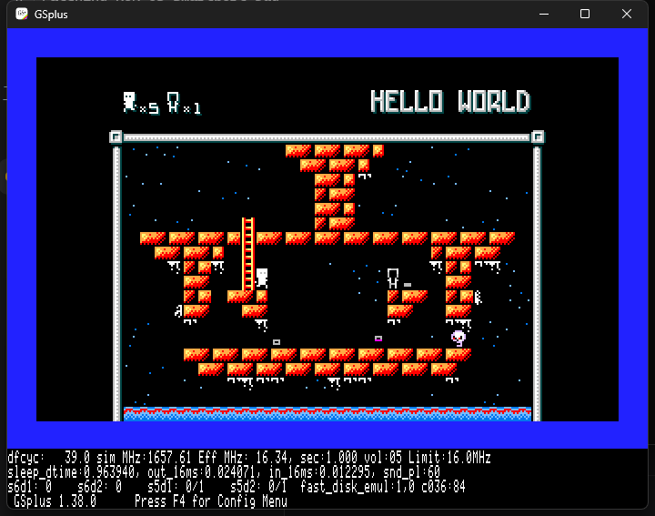

# Alter Ego — Apple IIgs / silky-gs port

This directory is the Apple IIgs work for the cc65 NES homebrew **Alter Ego**, built on
[silky-gs](https://github.com/lscharen/iigs-game-engine) (a native 65816 NES runtime, not an emulator).

This `iigs/` tree is added **alongside** the existing Apple II VERA port in this repository; the VERA
sources, tools and docs are not replaced or deleted.

It is a snapshot of the working tree that was used to bring Alter Ego up on GSplus, including the
current bootable 3.5" image:

- **Boot image:** [`emu/AlterEgoJml.2mg`](emu/AlterEgoJml.2mg) (10 MB ProDOS image)
- **Application:** [`src/games/alterego/AlterEgoGS`](src/games/alterego/AlterEgoGS) (259,395 bytes)
- **Current screen:** 

## Current status (2026-10-27, branch `test/gs`)

- Boots on GSplus; title → level 0 is playable.
- Playfield is the NES 32×20 tile map at **256×200** displayed inside the 320×200 SHR screen.
- Level name (`HELLO WORLD`), the top-left protagonist/clone counters, the player and the enemies are
  all drawn; **the full sprite bodies are visible in the current image**.
- `y_offset` is **0** in the committed configuration. Any non-zero `y_offset` tested so far removed
  the upper half of the 8×16 character/enemy sprites; that regression is documented in `AGENTS.md`.
- The NES bottom frame is still outside the 200-line viewport.
- The remaining layout request (move `HELLO WORLD` up, move the playfield up, and make the gap about
  one pixel) is **not implemented yet**; it needs the level name/HUD and the playfield to be rendered
  as separate bands rather than moving the whole background with `y_offset`.
- Audio is disabled in this image. The audio-enabled builds tried so far crashed GSplus with
  `Emulated state corrupt`; the working application is built from the audio-off PRG.

## Repository layout

```
iigs/
  src/games/alterego/    Alter Ego port: Main.s, Config.s, Hooks.s, game C/asm, assets, build.js
  src/core/, src/ppu/    silky-gs engine (the runtime this port is built on)
  scripts/               build, palette and image tooling
  macros/, src/rom/      shared Merlin32 macros and NES-ROM wrappers
  emu/AlterEgoJml.2mg    current bootable image (also the image the user reviews)
  emu/gsplus-*.kegs      GSplus configuration; s7d1 points at AlterEgoJml.2mg
  docs/screenshots/      reference captures
  docs/SILKY-GS-UPSTREAM-README.md   upstream silky-gs README
  AGENTS.md              working log, constraints and next steps
  CLAUDE.md              upstream engine guide (kept for reference)
```

## Build

Prerequisites (Windows): Node.js, Merlin32 and Cadius. The tool paths are in `package.json` under
`config`:

- `merlin32`: `C:\dev\Merlin32.exe`
- `cadius`: `C:\dev\cadius.exe`

From the repository root:

```powershell
cd iigs\src\games\alterego
node build.js
```

The build prints the segment sizes and writes `AlterEgoGS` (259,395 bytes). The input
`src/games/alterego/prg.bin` must stay exactly 32,768 bytes; `prg.bin` in this snapshot is the
audio-off baseline that produced the committed image.

## Repackage the boot image

Cadius replaces a file in place; stage the app under its ProDOS name first:

```powershell
cd iigs
New-Item -ItemType Directory tmp\repackage -Force | Out-Null
Copy-Item src\games\alterego\AlterEgoGS tmp\repackage\AlterEgoGS.S16 -Force
& C:\dev\cadius.exe REPLACEFILE .\emu\AlterEgoJml.2mg /ALTEREGO tmp\repackage\AlterEgoGS.S16
```

The image in `emu/` is a build artifact as well as the reference image, so replace it deliberately.

## Run in GSplus

`emu/gsplus-alterego-jml.kegs` has `s7d1` pointing at this checkout:

```powershell
Start-Process C:\dev\emu\GSplus\gsplus.exe `
  -ArgumentList '-cfg', (Resolve-Path .\emu\gsplus-alterego-jml.kegs)
```

Wait about **15 seconds** for the boot, then press **Return twice** (credits, then start). Earlier
inputs are lost; GSplus needs the window focus. The `.kegs` path is absolute, so edit `s7d1` if the
repository is checked out somewhere else.

## Notes on the port

- The image is **320×200 SHR**; the playfield is 128 SHR bytes (256 px) wide at `x_offset=16`, with
  16-byte side margins. NES scanlines 0–199 are shown.
- The level map is 32×20 tiles at NES nametable rows 6–25; the level name and counters are in the top
  rows.
- `y_offset` scrolls the rendered background up, but also shifts the sprite address in `SPR_SETUP`.
  In this port a non-zero offset broke the top half of 8×16 sprites; `y_offset=0` and an unshifted
  `SPR_SETUP` keep the characters whole. See `AGENTS.md` before changing it.
- `scripts/check-xbank.js` runs on every build: 16-bit references from MAIN/ENGINE into another bank
  fail the build. `__ROM0_LAST__` is `00F6B3`; `prg.bin` overflow/underflow must be checked.

## Provenance and licensing

The engine under `iigs/` is a snapshot of
[`lscharen/iigs-game-engine`](https://github.com/lscharen/iigs-game-engine) (silky-gs), Apache-2.0.
The upstream README is preserved at `docs/SILKY-GS-UPSTREAM-README.md`. The Alter Ego game sources
and assets retain their original project licensing; see the repository root `LICENSE` and the NES
project. Keep the upstream notices when redistributing this snapshot.

## Work log

See [`AGENTS.md`](AGENTS.md) for the dated work log, commands that were actually used, the
upper-body/`y_offset` investigation, and the next layout step.
