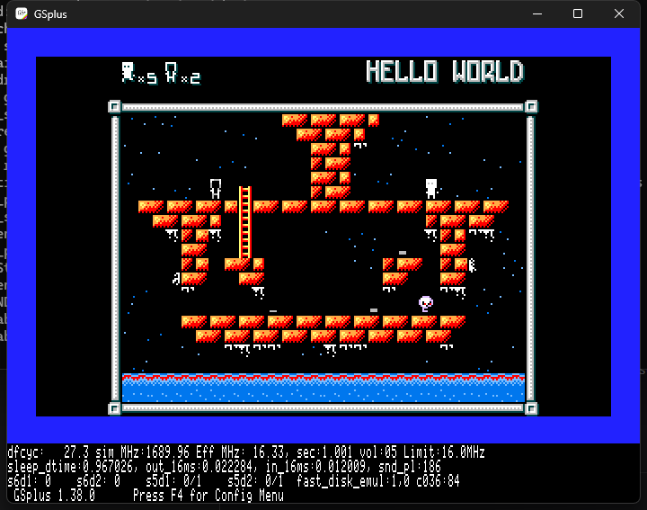
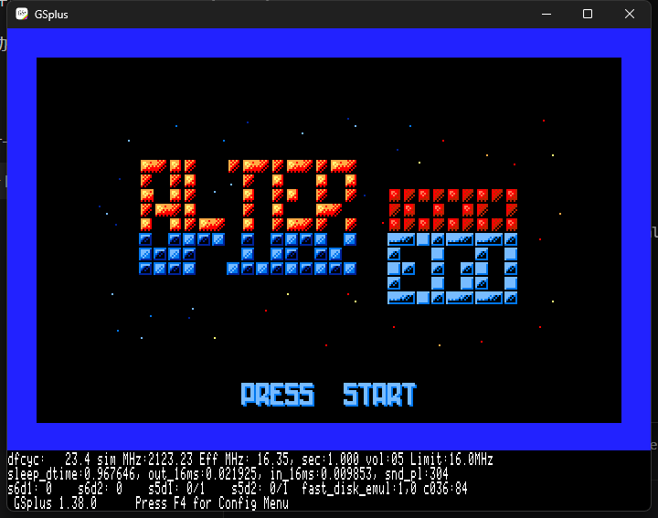

# Alter Ego — Apple IIgs / silky-gs port

This directory is the Apple IIgs work for the cc65 NES homebrew **Alter Ego**, built on
[silky-gs](https://github.com/lscharen/iigs-game-engine) (a native 65816 NES runtime, not an emulator).

This `iigs/` tree is added **alongside** the existing Apple II VERA port in this repository; the VERA
sources, tools and docs are not replaced or deleted.

It is a snapshot of the working tree that was used to bring Alter Ego up on GSplus, including the
current bootable 3.5" image:

- **Boot image:** [`emu/AlterEgoJml.2mg`](emu/AlterEgoJml.2mg) (10 MB ProDOS image)
- **Application:** [`src/games/alterego/AlterEgoGS`](src/games/alterego/AlterEgoGS) (268,253 bytes)
- **Current screen:** 
- **Title:** 

## Current status (2026-10-27, branch `test/gs`)

- Boots on GSplus; title → level 0 is playable, with music and SFX enabled.
- Playfield is the NES 32×20 tile map at **256×200** displayed inside the 320×200 SHR screen.
- Compact layout: the HUD (level name, man/ego counters) occupies SHR lines 0–16, the playfield and
  NES bottom frame are one continuous band at lines 17–199, and the outer frame lands flush on the
  last SHR line (no blank rows below it).  Gameplay sprites use the same −16 NES→SHR Y mapping.
- HUD is horizontally fixed (`NES_SetScroll` x=0, y=0); only the playfield and bottom frame use the
  game scroll.  The HUD activation check uses the `OAM_COPY` first word, not `spriteCount`.
- Audio is the original FamiTone2 driver and data, routed through the silky-gs APU model.  FamiTone
  is 8-bit code and its APU trampolines start at `$7E30`; both details are required, otherwise the
  status write corrupts the following APU instructions (the old `Emulated state corrupt` crash).
- A host loopback capture of GSplus gameplay measured RMS 3532 / peak 27610, confirming that the
  emulator is producing the game's music/SFX, not just running silently.

## Repository layout

```
iigs/
  src/games/alterego/    Alter Ego port: Main.s, Config.s, Hooks.s, game C/asm, assets, build.js
  src/core/, src/ppu/    silky-gs engine (the runtime this port is built on)
  scripts/               build, palette and image tooling
  macros/, src/rom/      shared Merlin32 macros and NES-ROM wrappers
  emu/AlterEgoJml.2mg    current bootable image (also the image the user reviews)
  emu/gsplus-*.kegs      GSplus configuration; s7d1 points at AlterEgoJml.2mg
  docs/screenshots/      reference captures
  docs/SILKY-GS-UPSTREAM-README.md   upstream silky-gs README
  AGENTS.md              working log, constraints and next steps
  CLAUDE.md              upstream engine guide (kept for reference)
```

## Build

Prerequisites (Windows): Node.js, Merlin32 and Cadius. The tool paths are in `package.json` under
`config`:

- `merlin32`: `C:\dev\Merlin32.exe`
- `cadius`: `C:\dev\cadius.exe`

From the repository root:

```powershell
cd iigs\src\games\alterego
node build.js
```

The build prints the segment sizes and writes `AlterEgoGS` (268,253 bytes). The input
`src/games/alterego/prg.bin` must stay exactly 32,768 bytes; the committed `prg.bin` is the
audio-enabled FamiTone build that produced the committed image.  The audio PRG is linked from the
cc65 objects in `build/silky` (the same `game.o`/`audio_silky.o` used here); no source rebuild is
needed for a normal app rebuild if `prg.bin` is already present.

## Repackage the boot image

Cadius replaces a file in place; stage the app under its ProDOS name first:

```powershell
cd iigs
New-Item -ItemType Directory tmp\repackage -Force | Out-Null
Copy-Item src\games\alterego\AlterEgoGS 'tmp\repackage\AlterEgoGS.S16#B3DB03' -Force
& C:\dev\cadius.exe REPLACEFILE .\emu\AlterEgoJml.2mg /ALTEREGO 'tmp\repackage\AlterEgoGS.S16#B3DB03'
```

The image in `emu/` is a build artifact as well as the reference image, so replace it deliberately.

## Run in GSplus

`emu/gsplus-alterego-jml.kegs` has `s7d1` pointing at this checkout:

```powershell
Start-Process C:\dev\emu\GSplus\gsplus.exe `
  -ArgumentList '-cfg', (Resolve-Path .\emu\gsplus-alterego-jml.kegs)
```

Wait about **20 seconds** for the boot, then press **Return** at the title. Earlier inputs are lost;
GSplus needs the window focus. The `.kegs` path is absolute, so edit `s7d1` if the repository is
checked out somewhere else.

## Notes on the port

- The image is **320×200 SHR**; the playfield is 128 SHR bytes (256 px) wide at `x_offset=16`, with
  16-byte side margins. NES scanlines 33–215 are shown in the game band.
- The level map is 32×20 tiles at NES nametable rows 6–25; the level name and counters are in the top
  rows.
- `y_offset` scrolls the rendered background up, but also shifts the sprite address in `SPR_SETUP`.
  In this port a non-zero offset broke the top half of 8×16 sprites; `y_offset=0` and an unshifted
  `SPR_SETUP` keep the characters whole. See `AGENTS.md` before changing it.
- `scripts/check-xbank.js` runs on every build: 16-bit references from MAIN/ENGINE into another bank
  fail the build. `__ROM0_LAST__` is `00F6B3`; `prg.bin` overflow/underflow must be checked.

## Provenance and licensing

The engine under `iigs/` is a snapshot of
[`lscharen/iigs-game-engine`](https://github.com/lscharen/iigs-game-engine) (silky-gs), Apache-2.0.
The upstream README is preserved at `docs/SILKY-GS-UPSTREAM-README.md`. The Alter Ego game sources
and assets retain their original project licensing; see the repository root `LICENSE` and the NES
project. Keep the upstream notices when redistributing this snapshot.

## Work log

See [`AGENTS.md`](AGENTS.md) for the dated work log, commands that were actually used, the
upper-body/`y_offset` investigation, and the next layout step.
